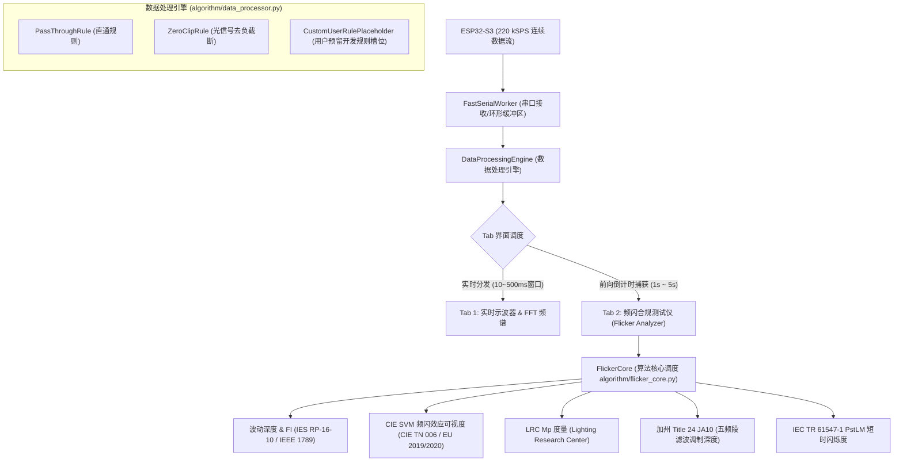

# ADS8688 光学频闪测试仪与数据处理引擎开发指南

本文档详细介绍了 `tools` 目录下集成的**光学频闪测试仪（Flicker Compliance Analyzer）**架构设计、**数据处理规则引擎（Data Processing Engine）**开发扩展方法、核心频闪算法原理以及测试验证规范。

---

## 1. 系统架构概览

系统采用**高内聚低耦合的分层架构**，将高速硬件采样、实时示波渲染、数据规则处理链以及多标准频闪评测算法清晰解耦：



---

## 2. 数据处理规则引擎扩展指南

数据处理引擎定义在 `tools/algorithm/data_processor.py` 中，采用**管道过滤器模式（Pipeline Pattern）**。所有从硬件采集到的数据在进入显示或算法前，都会依次穿过启用的规则链。

### 2.1 预留开发位置说明
在 `algorithm/data_processor.py` 中，专为后续规则扩展预留了 `CustomUserRulePlaceholder` 类：

```python
class CustomUserRulePlaceholder(BaseProcessingRule):
    """
    【预留开发位置】用户自定义数据处理规则 (User Custom Rule Slot)
    在此处添加您的具体处理规则，如：
      - 光谱响应修正 / 照度换算系数 (Lux = Voltage * K + B)
      - 基线漂移消除 / 移动平均滤波 (Baseline wander removal)
      - 50Hz/60Hz 工频陷波或带通滤波 (Notch / Bandpass filter)
      - 异常脉冲剔除 (Glitch / Outlier rejection)
      - 多项式非线性校准 (Polynomial calibration)
    """
    def __init__(self, name: str = "UserRuleSlot", enabled: bool = False, **kwargs):
        super().__init__(name, enabled)
        self.params = kwargs

    def process(self, data: np.ndarray, fs: float, context: Optional[Dict[str, Any]] = None) -> np.ndarray:
        if not self.enabled:
            return data

        processed_data = data.copy()

        # >>>>>> [在此直接编写您的自定义算法规则逻辑] <<<<<<
        # 示例 1: 增益与偏置物理量转换
        # gain = self.params.get('gain', 1.0)
        # offset = self.params.get('offset', 0.0)
        # processed_data = processed_data * gain + offset

        # 示例 2: 简单的滑动平均去噪
        # window_size = 5
        # processed_data = np.convolve(processed_data, np.ones(window_size)/window_size, mode='same')

        return processed_data
```

### 2.2 如何添加新规则
1. 继承 `BaseProcessingRule` 并实现 `process(self, data, fs, context)`；
2. 在 `DataProcessingEngine` 初始化中调用 `self.add_rule(MyNewRule())`；
3. 在 `ads8688_oscilloscope.py` 的“Data Processing Engine”界面控件中添加对应的 `QCheckBox` 绑定启用/禁用状态。

---

## 3. 频闪算法核心 (`algorithm/flicker_core.py`)

统一算法引擎对采集波形进行多维度的国际标准合规测试：

### 3.1 基础频闪指标 (IES / IEEE 1789)
- **波动深度 / 闪烁百分比 (Percent Flicker)**：
  $$\text{Percent Flicker} = \frac{A - B}{A + B} \times 100\%$$
  其中 $A$ 为波形极大值（峰），$B$ 为波形极小值（谷）。
- **闪烁指数 (Flicker Index, FI)**：
  $$\text{FI} = \frac{\text{Area above Mean}}{\text{Total Area}}$$
  反映了偏离平均光照的波形能量占总光通量的比例。

### 3.2 欧盟 ErP 频闪效应可视度 (CIE TN 006:2016 / EU 2019/2020)
- **SVM (Stroboscopic Visibility Measure)**：
  针对 0 ~ 2000 Hz 的调制峰值，结合人眼视觉灵敏度阈值函数 $T(f)$ 计算综合感知值：
  $$\text{SVM} = \left(\sum_{m} \left(\frac{C_m}{T(f_m)}\right)^{3.7}\right)^{1/3.7}$$
- **判定阈值**：
  - $\text{SVM} \le 0.4$：欧盟最高标准，完全免除频闪效应；
  - $0.4 < \text{SVM} \le 0.9$：低频闪可接受区间；
  - $\text{SVM} > 0.9$：超标，存在可见频闪效应风险。

### 3.3 主频闪频率抗基线漂移算法
- **机制**：在光波形中由于直流基准和温度/手部晃动慢漂移，FFT在 $<3\text{Hz}$ 区间可能产生巨大伪峰。
- **优化**：算法自动在 $\ge 3.0\text{ Hz}$ 区间寻找最强交流调制分量，确保市电 50Hz 下的白炽灯/整流 LED 能精确锁定 **100 Hz**。

### 3.4 加州 CEC Title 24 JA10
- **JA10 滤波调制深度**：
  对信号执行 FFT，并在 40 Hz、90 Hz、200 Hz、400 Hz、1000 Hz 截止频率截断高频后逆变换（IFFT），分别计算各频段内的波动深度。

### 3.5 IEC TR 61547-1 PstLM 短时闪烁度
- 基于双二阶带通滤波、Bilinear 加权、平方积分平滑与累积概率统计（CPF），评估 0.5 ~ 35 Hz 低频肉眼可见的明暗闪烁。阈值要求 $\text{PstLM} \le 1.0$。

---

## 4. 实时向前倒计时捕获机制

为了兼顾“示波器 60FPS 实时显示”与“频闪分析所需的长时新鲜数据”，系统采用**向前事件驱动捕获**机制：

1. **点击“⚡ 开始频闪捕获与分析”**：
   - 界面弹出采样进度条并清空新鲜缓冲队列；
   - 标记 `is_collecting_flicker = True`；
2. **高速累加**：
   - 串口接收线程持续推入 220 kSPS 数据块，主线程累加样本点；
   - 状态栏与进度条实时更新（例如 `[=====>    ] 3.2s / 5.0s (64%)`）；
3. **样本集齐与后台运算**：
   - 达到目标点数（如 5 秒 = 1,100,000 点）后立即停止捕获；
   - 启动异步后台工作线程 `FlickerAnalysisWorker(QThread)` 进行多算法矩阵运算；
   - 计算完毕后通过 PyQt 信号安全回填 UI 卡片和波形图表，界面全程保持流畅不卡顿。

---

## 5. 白炽灯实测基准数据参考

以下为在 50Hz 市电环境下使用 ADS8688 配合光敏传感器测试白炽灯的实测基线数据，可作为算法验收的标准对照：

| 测试项目 | 实测参考值 | 物理特性与评估结论 |
| :--- | :--- | :--- |
| **主频闪频率** | **100.7 Hz** | 准确锁定市电 50Hz 经过正负半周热辐射的 2 倍工频 ($100\text{Hz}$) |
| **波动深度 (Percent Flicker)** | **15.38 %** | 处于白炽灯典型的 10%~20% 钨丝热惯性范围内 |
| **闪烁指数 (Flicker Index)** | **0.0444** | 吻合正弦波动理论比例 |
| **CIE SVM** | **0.534** | 符合欧盟 ErP 合格标准（$\le 0.9$） |
| **IEC PstLM** | **0.130** | 远低于 1.0 门限，肉眼直视无可见明暗闪烁 |
| **加州 JA10 (≤90Hz)** | **8.88 %** | 低于 100Hz 主频，能量大部分被滤除 |
| **加州 JA10 (≤200Hz)** | **14.61 %** | 跨过 100Hz 截止频率后能量突增，吻合物理规律 |

---

## 6. 使用与导出说明

1. **运行上位机**：
   ```powershell
   cd tools
   uv run python ads8688_oscilloscope.py
   ```
2. **连接设备**：在右上角选择 ESP32 对应的串口与波特率，点击 **Connect**。
3. **切换标签页**：
   - **Tab 1: 实时示波器**：观察 220 kSPS 高频连续波形与触发；
   - **Tab 2: 频闪测试仪**：选择 1s / 2s / 5s 采集时长，点击 **“开始频闪捕获与分析”**；
4. **导出报告**：点击 **“📄 导出频闪报告 (Export CSV)”**，即可将包含测试时间、采样率、点数、SVM、PstLM、JA10 全指标保存为标准的 CSV 质检报告。
